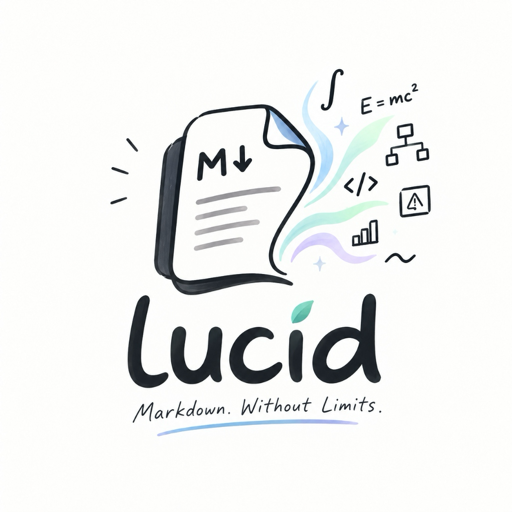

<p align="center">
  
</p>

<h1 align="center">Lucid for macOS</h1>

<p align="center">
  <strong>A quiet, native Markdown reader &amp; editor for technical documents.</strong><br>
  Equations, chemistry, Mermaid diagrams, code and wide tables, rendered offline.
</p>

<p align="center">
  <a href="https://github.com/ajayuhjain89/lucid-releases/releases/latest"><strong>Download the latest release</strong></a> &nbsp;•&nbsp;
  <a href="https://website-phi-umber-70.vercel.app"><strong>Website</strong></a> &nbsp;•&nbsp;
  <a href="https://website-phi-umber-70.vercel.app/changelog">Changelog</a>
</p>

---

This repository publishes Lucid's releases: the signed disk images and their release notes.
It contains no source code.

## Install

1. Download `Lucid-<version>.dmg` from the [latest release](https://github.com/ajayuhjain89/lucid-releases/releases/latest).
2. Open it and drag **Lucid.app** into **Applications**.
3. On first launch, macOS may say it can't verify the developer (Lucid is ad-hoc signed and
   not notarized). Click **Done**, open **System Settings → Privacy & Security**, and click
   **Open Anyway** next to the message about Lucid.

Later versions install from inside the app: **Lucid → Check for Updates…**

Requires macOS 14 Sonoma or later on Apple Silicon.

## Verify a download

Each release lists the DMG's SHA-256 checksum:

```bash
shasum -a 256 ~/Downloads/Lucid-1.1.0.dmg
```

## Report a problem

[Open an issue](https://github.com/ajayuhjain89/lucid-releases/issues/new) with your macOS
version, Lucid version (Lucid → About Lucid) and, if you can, a small Markdown sample.

## License

© 2026 Ayush Jain. All rights reserved. Lucid is free to download and use.
